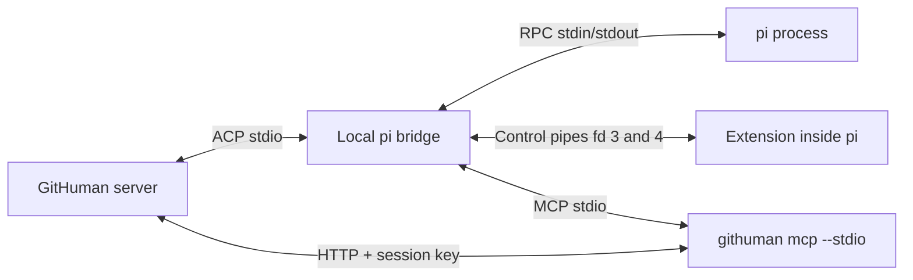

# pi and MCP integration in GitHuman

[Русская версия](pi-mcp-integration.md)

This guide is for GitHuman developers and maintainers. It describes the local pi bridge, trust boundaries, failure handling, and verification procedures. The source code and tests in this repository define the behavior. This guide does not cover third-party ACP adapters for pi.

The English text uses short sentences, active voice, and consistent technical terms. It does not claim certified ASD-STE100 compliance.

## 1. Integration components

GitHuman includes the ACP adapter `githuman pi-acp --stdio`. The adapter starts the installed pi executable in RPC mode. A separate MCP registry starts MCP servers and discovers their tools. It sends the tool descriptors to a trusted extension inside pi. The artifact MCP server uses `githuman mcp --stdio`.

The integration has three separate protocol paths:



The artifact bridge is the HTTP route `POST /api/agent/artifacts/:operation`. The control channel uses separate pipes between the adapter and extension. Use these terms separately during diagnosis.

The registry discovers and calls MCP tools. It does not expose separate MCP resources, prompts, or subscription interfaces to pi. A resource block in a tool result is response content. It does not enable independent MCP resource reads.

Artifact MCP requires a live GitHuman agent session. It does not operate as a standalone service. A manual `pi-acp` launch starts a protocol process. It does not open an interactive CLI.

## 2. Requirements and setup

1. Use Node.js 24 or later. Use the pnpm version specified in `package.json`.
2. Install pi separately. Make sure the GitHuman process can find `pi` in its `PATH`.
3. Configure a model and authorization in the installed pi. The bridge uses that configuration.
4. Start GitHuman. Select the standard `pi` preset in the chat panel.
5. Wait until the chat is ready. Check a normal model response. Then check an MCP tool call.

The standard preset uses `process.execPath` and the absolute path of the current CLI. Its arguments select `pi-acp --stdio`. It does not need a runtime `npx` adapter. Source launches use `index.ts`. Compiled launches use `index.js`.

Preset availability checks the executable and `requires: pi` in `PATH`. It does not check authorization, the selected model, or the extension handshake. A preset can appear available and still fail during startup.

Set `PI_ACP_PI_COMMAND` in the preset environment to select another pi executable. Supply a program path, not a shell command with arguments. The standard preset availability check still requires `pi` in `PATH`.

GitHuman preserves user `command`, `args`, and `env` overrides from `.githuman/ght-agents.json`. For a validator with preset ID `pi`, the server rejects a launch that differs from its trusted local launcher. Restore the standard launcher. Do not remove the check to bypass this error.

### Runtime compatibility

Before launch, the adapter calls `pi --help` in an empty temporary directory. The probe uses a separate `HOME` and `PI_CODING_AGENT_DIR`. It also sets `PI_OFFLINE=1`. The probe has a 10-second deadline and a 256 KiB stdout limit.

The adapter checks these required flags instead of relying only on a version number:

```text
--mode --no-session --no-extensions --no-skills --no-prompt-templates
--no-themes --no-context-files --no-builtin-tools --offline
```

Both profiles require this capability check. The chat profile does not use all these flags. If a required flag is missing, startup stops. A successful probe does not replace the extension handshake or model check.

The runtime matrix has these control versions: `0.81.0`, `0.85.1`, `0.99.0`, `1.0.0`, `1.1.0`, and `1.4.0`. Versions between these control points are not claimed as verified. Linux is verified. The code permits macOS, but macOS verification was skipped. Windows is rejected.

## 3. Chat and validator profiles

| Property | `chat` | `validator` |
| --- | --- | --- |
| Installed pi model configuration and authorization | Used | Used |
| pi session persistence | Disabled with `--no-session` | Disabled with `--no-session` |
| Themes | Disabled | Disabled |
| User extensions, skills, prompt templates, and context files | The bridge does not disable them | Disabled with isolation flags |
| Built-in pi tools | Available according to pi configuration | Disabled |
| Native pi MCP | The bridge does not disable it separately | `--no-mcp` when the runtime reports this flag |
| Tools from the bridge registry | ACP permission gate | Server permission policy |
| Slash commands | Allowed, except `/reload` | Rejected |
| General GitHuman `autoApprove` | Can answer MCP permission requests | Does not replace the server policy |

**ACP permissions protect MCP calls through the bridge registry. They do not control native tools in a normal pi chat.** Native `bash`, `write`, or a tool from another extension can execute without a GitHuman permission card. A disabled `autoApprove` setting does not make the chat a sandbox.

The server selects `GITHUMAN_PI_PROFILE` after it applies `preset.env`. An environment override cannot change a server validator to the `chat` profile. Setting this variable outside the server launch does not grant validator authorization.

For the trusted launcher, the server checks `_meta.githumanBridge` in the `session/new` response. It requires `version: 1`, the expected `profile`, and `registryGeneration: 1`. Launcher matching compares the executable and every argument exactly. A similar command name or path is insufficient.

The validator extension activates only the tools from the supplied registry. An additional `tool_call` guard blocks other tools. These controls and the permission policy are not an operating-system sandbox. The `--offline` flag does not block model network requests. The configured provider connection is still required. Normal chat extensions execute inside the pi process. Do not treat them as isolated from the trusted extension.

## 4. Startup and tool registration

One `pi-acp` process accepts exactly one `session/new`. A second attempt requires a new process, even if the first attempt failed. The adapter does not support `session/load`. It also rejects HTTP and SSE MCP descriptors.

Startup sequence:

1. The server creates an agent session. It supplies the `githuman_artifacts` stdio descriptor with an HTTP bridge address and session key.
2. The registry connects to the MCP servers. It reads every `tools/list` page and collects MCP initialize instructions.
3. The adapter probes the runtime. It starts pi with the trusted extension.
4. The extension sends `hello`. The adapter sends `configure` with the profile, tools, and instructions.
5. At the first `session_start`, the extension checks for name collisions. It registers the tools and sends `ready`.
6. The adapter reads the pi state, model catalog, and available thinking levels. Startup fails if no model is configured.
7. The server checks the ACP bridge acknowledgment. The chat can then become ready.

The registry stays fixed for the session. The bridge does not refresh tools through `tools/list_changed`. Create a new chat after a tool or extension change. The adapter rejects `/reload` before execution. A repeated `session_start` makes the extension close the process.

### Names and schemas

The operation `tasks.get_context` becomes the MCP tool `tasks_get_context`. Its pi tool name is:

```text
mcp__githuman_artifacts__tasks_get_context
```

The registry maps this qualified name to the original server and tool. It sends the original tool name to the MCP server. It does not resolve an arbitrary model string as a backend address.

| Check | Failure behavior |
| --- | --- |
| No more than 8 MCP servers; unique server names | Startup stops. Existing connections close |
| Server and tool names match `[a-zA-Z0-9_-]+` | Startup stops |
| Qualified tool name has no more than 128 characters | Startup stops |
| No more than 512 tools across all servers | Startup stops |
| No more than 32 `tools/list` pages per server; no repeated cursor | Startup stops |
| No duplicate variable name in `server.env` | Startup stops |
| No collision with an installed pi extension tool | The extension reports a fatal error. Remove the collision and create a new chat |

The registry reserves these original tool names: `read`, `write`, `edit`, `bash`, `powershell`, `grep`, `find`, `ls`, `tool_search`, and `codemode`. A server prefix does not make these names acceptable.

Before it requests permission, the adapter makes a JSON copy of the arguments. It validates that copy against the registered JSON Schema with AJV. The permission gate and MCP backend receive the same argument snapshot. A later change to the original object cannot change the approved call.

## 5. MCP permission and execution

For each model turn, the adapter increases `generation`. It waits for a `begun` acknowledgment. The extension sends each call through the control channel. A call contains an ID, generation, qualified name, and arguments.

The adapter checks the active turn, generation, unique call ID, and limits. It validates the argument schema. It then sends ACP `session/request_permission` with:

- the qualified name and copied arguments;
- `_meta.githumanPi.server` and the original tool name in `_meta.githumanPi.tool`;
- `registryGeneration: 1`;
- `allow_once` and `reject_once` options.

The backend executes only after an `allow_once` selection. A dismissed card, rejection, cancellation, timeout, or different option ID does not permit execution. After permission arrives, the bridge checks generation and cancellation again.

An ordinary MCP call failure returns `isError: true` with `Pi MCP call failed, was denied, or was cancelled.` The extension also converts a valid MCP response with `isError: true` into a tool error. A protocol violation closes the session. Examples include a repeated call ID or an incorrect generation.

Permission does not prove that a write succeeded. If the response is lost after execution, the server may already have committed the write. For operations with `requestId`, retry the original arguments with the same ID. Do not generate a new ID automatically.

### Results and prompt content

| Data | Conversion |
| --- | --- |
| MCP text and image blocks | Passed to the pi tool result |
| MCP embedded resource with text | Converted to a text block |
| Other MCP blocks | Converted to JSON text |
| MCP `structuredContent` | Stored in `details.structuredContent` |
| Tool result in the ACP chat | Text blocks are displayed. This converter does not display images or details |
| ACP prompt image | Passed to pi as base64 without a data URL prefix |
| ACP resource link | Converted to a text hint with the URI. The converter does not fetch the resource |
| ACP embedded text | Added to the message with its URI and MIME type |
| ACP embedded blob | Added as a MIME type and size description. Blob bytes do not become model text |
| ACP audio | Added as an unsupported-audio marker with its size |
| Unknown prompt block type | Ignored |

The model result and chat panel do not necessarily show the same data. To diagnose a structured response, inspect the MCP result and its test. Do not rely only on the permission or tool card text.

The bridge sends model text and thinking through separate ACP events. Stop reasons `length` and `refusal` become `max_tokens` and `refusal`. Cancellation returns `cancelled`. A model error rejects the prompt. Successful turn completion does not prove that every tool succeeded.

Settings accept only known model IDs and thinking levels returned by the runtime. After a model change, the bridge reads thinking levels again. It loads the model catalog at session startup. Create a new chat to load a changed model configuration.

## 6. HTTP bridge access and secrets

An agent session key contains 32 random bytes encoded as 64 lowercase hexadecimal characters. The server stores its hash in memory. The key belongs to one live session. It is separate from a device cookie.

The registry supplies `GITHUMAN_AGENT_URL` and `GITHUMAN_AGENT_KEY` through the MCP descriptor environment. Before it starts pi, the adapter removes these variables and `GITHUMAN_PI_PROFILE` from the pi child environment. It passes the control nonce through `GITHUMAN_PI_NONCE`. The extension deletes this variable after reading it. These steps reduce secret inheritance. They do not isolate code inside the pi process.

The key authenticates only the matched route and method `POST /api/agent/artifacts/:operation`. It grants no access to other APIs. It is required on loopback too. Host and Origin checks still apply. The server assigns the operation actor.

The MCP CLI accepts a root HTTP address. The address must have no username, password, extra path, query, or fragment. Redirects are rejected. This path is an internal local connection. Do not replace it with an external HTTPS MCP server address.

When a session closes, the server revokes its key and closes tracked requests. A new MCP descriptor request replaces the previous key for that session. Device revocation closes its associated session. A server restart does not restore the old in-memory keys.

Do not put descriptor environments, Authorization headers, or raw provider responses in logs or reports. The adapter converts model failures into safe categories: authorization, model selection, connection, provider limit, or general failure. It drains pi and MCP stderr. Those streams are not the user protocol.

## 7. Artifact validator rules

The validator has a separate server permission policy. This policy takes precedence over general auto-approval. A policy rejection does not offer a manual bypass.

Only these operations are permitted:

```text
validations.get
validations.manifest
validations.read
validations.read_next
validations.submit
validations.create_report
artifacts.get_content
```

The server checks the tool name and origin, argument schema, assigned validation ID, live session, lease owner, lease expiry, and validation freshness. For `validations.read` and `artifacts.get_content`, the document ID must appear in the manifest's `requiredContentIds`. Registry membership alone does not authorize a validator call.

The validator must read every manifest page and all required content. Call `validations.read_next` until `remaining` is 0. The server returns the next unread content in manifest order, up to 24 KiB per call. Use `validations.read` with `nextOffset` only to read a document again. Copy complete UUIDs from the manifest, including `findings[].artifactId`. An abbreviated UUID fails schema validation.

Document content is untrusted data. An instruction inside a document cannot authorize shell access, another file read, a nested validation, or a graph change. The policy rejects operations outside its allowlist regardless of model text.

A report has a `pass`, `conflict`, or `incomplete` verdict. A `pass` verdict does not accept a document or execute a commit. Application remains a separate server operation with lifecycle checks and user consent. See the [artifact lifecycle](artifact-lifecycle.md) and [capability matrix](artifact-capabilities.md). These linked guides are in Russian.

A stop or error before complete submission produces `incomplete`. If the policy rejected a call, the server includes the last rejection reason in its stop diagnosis. The validation has a 10-minute limit. A single pi turn has a separate 5-minute limit.

After completion, the server closes and removes the validator session. The client removes its tab when it refreshes the session list. This also works after a missed close event. Read the transition operation and validation report for the result. The chat tab is not a permanent audit log.

## 8. Tasks and request replay

MCP initialize instructions and the trusted extension supply task rules before the first model turn. The server also supplies a short reminder. Instructions guide the model sequence. Server versions protect writes against concurrent changes.

- `tasks.create` creates a task. It does not change the chat selection.
- Read `tasks.get_context` before each `tasks.activate` or `tasks.create_and_activate` call.
- Pass the returned `turnId` and `assignment.version` unchanged.
- Perform a single requested activation before related work and artifact creation.
- If the user requests several creations and activations without choosing one task, create them without activation. Ask which task to select.
- Explicit `metadata.taskIds`, including `[]`, override assignment inheritance for the current response.
- After a conflict, read context again and ask the user. Do not retry activation with a new version without their decision.
- After an uncertain network result, retry the same request and `requestId`. `replayed: true` returns the original receipt. It does not activate the task again.

Do not infer the current selection from an old receipt. Task titles, documents, and tool responses are data. They are not instructions to change the selected task.

## 9. Cancellation, closure, and crashes

Turn cancellation aborts its `AbortSignal`. It sends `cancel` to the extension and RPC `abort` to pi. The extension resets generation and rejects pending calls. The adapter does not send an old turn result into a new turn. Cancellation does not roll back a server write that already committed.

| Condition | Result and maintainer action |
| --- | --- |
| Cancellation while a permission card is open | A late permission must not start the backend. Wait for cancellation before starting another turn |
| Cancellation during an MCP request | The signal reaches the MCP SDK. The CLI also aborts HTTP fetch. Check operation state before a write retry |
| Late result after timeout or cancellation | One response for a known rejected call is discarded, including after a generation change. An unknown or repeated result closes the extension |
| Unknown session ID or concurrent second prompt | The request is rejected |
| Model or thinking change during a turn | The change is rejected. Wait for the turn to finish |
| Unexpected MCP server closure | The whole pi session closes. The bridge does not continue with a partial registry |
| pi exit or control pipe closure | Pending RPC requests fail. The session closes |
| EOF, invalid JSON, version, or nonce on the control channel | The session stops. Permissions do not continue through the damaged channel |
| Invalid JSON on pi RPC stdout | The line is skipped. Buffer overflow or a parsed non-object value closes the process |
| ACP connection closure | The bridge closes pi and the MCP registry |
| GitHuman restart | A new session is required. Server recovery handles unfinished transition operations without automatic application |

During normal closure, the adapter requests process-tree termination. It sends `SIGHUP`, waits 200 ms, then sends `SIGKILL`. A bounded `ps` call discovers descendants. A discovery failure does not prevent termination of the known process.

**Known limitation:** native shell commands from a normal chat can survive a pi crash or `SIGKILL`. After the parent exits, the adapter cannot always identify a detached descendant. Cleanup of these commands is best effort. Before manual termination, confirm process ownership from its PID, command, and working context. Do not terminate every process named `pi` or `node`.

This limitation does not relax the MCP permission gate or validator controls. The crash test permits a surviving native process. It reports the condition and removes that process during test cleanup.

## 10. Limits and deadlines

These values describe the current implementation. They are not external pi guarantees.

| Path | Limit |
| --- | --- |
| `pi --help` probe | 10 s; 256 KiB stdout |
| Control handshake | 30 s |
| MCP connect, each tools/list page, MCP call | 30 s per request |
| ACP permission wait | Up to 30 s. The same signal then limits the MCP call |
| Extension tool result wait | 30 s from call submission, including permission |
| Ordinary pi RPC request | 30 s |
| Prompt RPC and turn completion | 300 s |
| Turn acknowledgment `begun` | 30 s |
| Server artifact validation | 10 min |
| Pending calls | Up to 64 in the respective RPC, MCP, and extension queues |
| Unique MCP call IDs per turn | Up to 10,000 |
| Extension rejected-call history | Up to 10,000 IDs. Overflow removes the oldest ID. A late response consumes its entry |
| Control/RPC input buffer | 16 MiB. The check includes accumulated bytes and the incoming chunk |
| Control output | One line up to 16 MiB. The check also limits the accumulated writable buffer |
| MCP stdio client buffer | 16 MiB |
| Artifact bridge HTTP body | 12 MiB |
| Artifact CLI input MCP message | 13 MiB |

Discovery can make several sequential requests. A 30-second request limit is not a total discovery deadline. Deadlines on different layers overlap. A long permission wait leaves less backend time. Do not describe this as 30 seconds for permission plus 30 seconds for execution.

## 11. Troubleshooting

| Message or symptom | Check |
| --- | --- |
| Preset unavailable | GitHuman process `PATH`; installed `pi` and executable Node |
| `could not probe the installed pi executable` | `PI_ACP_PI_COMMAND`, execute permissions, `pi --help`, and probe deadline |
| `required RPC/isolation flags are missing` | Runtime compatibility. Do not bypass isolation flags |
| `requires a configured model and authorization` | Installed pi configuration in the server's environment |
| `model authorization failed` | pi authorization. Do not paste secrets into an issue |
| `model connection failed` | Endpoint, network access, and provider configuration |
| `provider limit was reached` | Provider quota and rate limit. Retry after the cause is resolved |
| `did not confirm its launch profile and MCP registry` | Local CLI and extension versions. Do not mix files from different builds |
| `tool name collision` | Qualified names in user extensions. Remove the collision and create a new chat |
| `reload requires a new chat` | Close the chat and create another one instead of using `/reload` |
| `Pi MCP call failed, was denied, or was cancelled.` | Permission card, cancellation, deadlines, and server operation result |
| `Validation permission denied` | Allowlist, complete UUID, assigned manifest, freshness, and validation lease |
| Validator ends as `incomplete` | Report and stop reason; complete manifest/content reads, submission, model, and deadlines |
| Request disconnects after a write | Operation state. Retry with the original `requestId` and arguments |

Do not change the policy, deadline, or profile only to remove an error message. First identify the failing path: ACP, control channel, pi RPC, MCP stdio, or artifact HTTP bridge.

## 12. Verification procedures

Run ordinary checks without an installed pi runtime:

```sh
node --test tests/server/adapters/pi-acp/*.test.ts
node --test tests/cli/commands/pi-acp.test.ts
pnpm run typecheck
pnpm run lint:check
```

Real-runtime tests skip when `GITHUMAN_PI_SPIKE_COMMAND` is absent. A successful ordinary test command does not verify the installed pi runtime.

Use the pinned runtime matrix:

```sh
pnpm run test:pi-matrix --install
pnpm run test:pi-matrix
pnpm run test:pi-matrix --runtime 1.4.0 --install
```

The first command installs fixture dependencies with `--ignore-workspace --frozen-lockfile --ignore-scripts`. Runtime directories are excluded from the application workspace. Their lock files pin transitive dependencies. The script also rejects mixed pi package-family versions. Do not remove the lock files without changing this contract.

The matrix creates temporary POSIX `bin/pi` symlink launchers. It does not replace the user's global pi. The scenarios use the real runtime and a local model HTTP fixture. They do not test external model quality or real provider authorization.

| Test file | Evidence |
| --- | --- |
| `extension.test.ts` | Timer and listener cleanup, send failures, cancellation, late results, and unknown ID rejection without installed pi |
| `control.test.ts` | Fragmented UTF-8, frame checks, and buffer limit |
| `mcp.test.ts` | Argument snapshot, schema validation, original name, and HTTP descriptor rejection |
| `launch.test.ts` | Exact launcher matching and legacy validator rejection before spawn |
| `errors.test.ts` | Error categories without raw provider secrets |
| `control-spike.test.ts` | Control descriptor isolation from native bash, handshake failures, and normal cleanup |
| `session.test.ts` | Allow/deny/cancel, native validator tool rejection, extension isolation, settings, and collisions |
| `validation.test.ts` | Real pi → MCP → HTTP path, pagination, content reads, and three verdicts without document acceptance |
| `tasks.test.ts` | Activation, create-only, explicit taskIds, empty assignment, and assignment conflict |
| `crash.test.ts` | Bridge closure after a crash and visibility of the native cleanup limitation |

This table describes existing tests. It does not claim complete branch coverage. Some registry limits and races are defined by code without a separate test for each case.

For manual acceptance, use an authorized real model. Check a normal response, allowed MCP call, rejected MCP call, and cancellation at the permission card. Change the model after a completed turn. Complete artifact validation and inspect its report. Confirm that the validator tab disappears. Check for unintended writes after rejection and cancellation. Verify macOS separately on a macOS host.

## 13. Source map

Paths below are relative to the repository root.

| File | Responsibility |
| --- | --- |
| [`src/cli/commands/pi-acp.ts`](../src/cli/commands/pi-acp.ts) | ACP stdio entry point and launch profile |
| [`agent.ts`](../src/server/adapters/pi-acp/agent.ts) | ACP handlers and bridge acknowledgment |
| [`session.ts`](../src/server/adapters/pi-acp/session.ts) | Turns, permission gate, generation, configuration, and events |
| [`process.ts`](../src/server/adapters/pi-acp/process.ts) | pi launch, RPC, and handshake |
| [`control.ts`](../src/server/adapters/pi-acp/control.ts) | Control channel format and limits |
| [`extension.ts`](../src/server/adapters/pi-acp/extension.ts) | Tool registration inside pi and validator guard |
| [`mcp.ts`](../src/server/adapters/pi-acp/mcp.ts) | MCP clients, discovery, schemas, and routing |
| [`compatibility.ts`](../src/server/adapters/pi-acp/compatibility.ts) | Runtime probe and profile flags |
| [`launch.ts`](../src/server/adapters/pi-acp/launch.ts) | Trusted launcher identity |
| [`session-registry.ts`](../src/server/services/agent/session-registry.ts) | Sessions, keys, revocation, and MCP descriptors |
| [`artifact-permission.ts`](../src/server/adapters/agents/artifact-permission.ts) | Permission request origin checks |
| [`artifact-validation-jobs.service.ts`](../src/server/services/artifact-validation-jobs.service.ts) | Validator scope, allowlist, lease, and completion |
| [`src/cli/commands/mcp.ts`](../src/cli/commands/mcp.ts) | MCP tools to artifact HTTP bridge |
| [`scripts/test-pi-matrix.mjs`](../scripts/test-pi-matrix.mjs) | Runtime matrix installation and verification |

Related guides are in Russian: [agent context](agent-context-uris.md), [artifact storage](artifact-storage.md), [artifact graph](artifact-graph.md), and [glossary](GLOSSARY.md).
