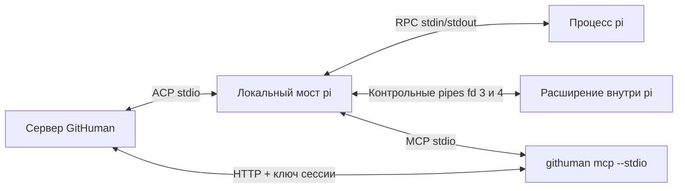

# Интеграция pi с MCP в GitHuman

[English](pi-mcp-integration.en.md)

Руководство для разработчиков и сопровождающих GitHuman. Оно описывает локальный мост pi, его границы доверия, обработку отказов и проверку изменений. Источник поведения — код и тесты этого репозитория. Документ не описывает произвольные сторонние ACP-адаптеры pi.

## 1. Что входит в интеграцию

GitHuman поставляет ACP-адаптер `githuman pi-acp --stdio`. Адаптер запускает установленный исполняемый файл pi в режиме RPC. Отдельный MCP registry запускает MCP-серверы, получает их инструменты и передаёт описания доверенному расширению pi. Для работы с артефактами используется MCP-команда `githuman mcp --stdio`.

Это три разных протокольных участка:



Мост артефактов — HTTP-маршрут `POST /api/agent/artifacts/:operation`. Контрольный канал — отдельные pipes между адаптером и расширением. Смешивать эти понятия при диагностике нельзя.

Registry реализует discovery и вызовы MCP tools. Он не предоставляет pi отдельные интерфейсы MCP resources, prompts или subscriptions. Resource-блок в результате инструмента — это содержимое ответа, а не поддержка самостоятельного чтения MCP resources.

Самостоятельный MCP артефактов без работающей агентской сессии GitHuman не поддерживается. Запуск `pi-acp` вручную открывает протокольный процесс; это не интерактивный CLI.

## 2. Требования и настройка

1. Используйте Node.js версии 24 или новее и пакетный менеджер pnpm из `package.json`.
2. Установите pi отдельно. Проверьте, что процесс GitHuman видит `pi` в своём `PATH`.
3. Настройте в установленном pi модель и авторизацию. Мост использует эту конфигурацию.
4. Запустите GitHuman и выберите штатный preset `pi` в панели чатов.
5. Дождитесь готовности чата. Проверьте обычный ответ модели, затем вызов MCP-инструмента.

Штатный preset запускает `process.execPath` с абсолютным путём текущего CLI и аргументами `pi-acp --stdio`. Runtime `npx` для этого не нужен. В исходниках используется `index.ts`, в сборке — `index.js`.

Признак доступности preset проверяет наличие команды и `requires: pi` в `PATH`. Он не проверяет авторизацию, модель или успешный handshake. Поэтому доступный в списке preset ещё может завершиться ошибкой при запуске.

Путь к другому исполняемому файлу pi можно передать через `PI_ACP_PI_COMMAND` в окружении preset. Это путь к программе, а не shell-команда с аргументами. Проверка доступности штатного preset всё равно требует `pi` в `PATH`.

Пользовательские `command`, `args` и `env` из `.githuman/ght-agents.json` сохраняются. Для валидатора с preset ID `pi` сервер отклоняет команду, которая не совпадает с доверенным локальным запуском. Не исправляйте это снятием проверки: восстановите штатный launcher.

### Совместимость runtime

Перед запуском адаптер вызывает `pi --help` в пустом временном каталоге с отдельным `HOME`, `PI_CODING_AGENT_DIR` и `PI_OFFLINE=1`. На probe отведено 10 секунд; предел stdout — 256 КиБ. Адаптер проверяет наличие необходимых флагов, а не только номер версии:

```text
--mode --no-session --no-extensions --no-skills --no-prompt-templates
--no-themes --no-context-files --no-builtin-tools --offline
```

Проверка нужна для обоих профилей, хотя обычный чат использует не все эти флаги. Если runtime не сообщает нужный флаг, запуск прекращается. Успешный probe не заменяет handshake расширения и проверку модели.

Контрольные версии матрицы: `0.81.0`, `0.85.1`, `0.99.0`, `1.0.0`, `1.1.0`, `1.4.0`. Проверки на промежуточных версиях не заявлены. Linux проверен. Код допускает macOS, но проверки macOS пропущены; подтверждённой поддержки нет. Windows отклоняется.

## 3. Обычный чат и валидатор

| Свойство | `chat` | `validator` |
| --- | --- | --- |
| Конфигурация модели и авторизация pi | Используются | Используются |
| Сохранение pi-сессии | Отключено через `--no-session` | Отключено через `--no-session` |
| Темы | Отключены | Отключены |
| Пользовательские расширения, skills, prompt templates, context files | Мост не отключает | Отключены флагами изоляции |
| Встроенные инструменты pi | Доступны по конфигурации pi | Отключены |
| Native MCP pi | Мост отдельно не отключает | `--no-mcp`, если runtime сообщает этот флаг |
| Инструменты локального registry | Через ACP permission gate | Через серверную permission policy |
| Slash-команды | Допустимы, кроме `/reload` | Запрещены |
| Общий `autoApprove` GitHuman | Может отвечать на MCP-разрешения | Не заменяет серверную policy |

**ACP-разрешения защищают вызовы MCP registry моста. Они не контролируют native tools обычного чата pi.** Например, native `bash`, `write` или инструмент другого расширения может работать без карточки разрешения GitHuman. Выключенный `autoApprove` не превращает обычный чат в песочницу.

Сервер выбирает `GITHUMAN_PI_PROFILE` после наложения `preset.env`. Поэтому override окружения не может перевести серверный валидатор в профиль `chat`. Ручная установка этой переменной вне серверного запуска не создаёт авторизацию валидатора.

Для доверенного launcher сервер требует ответ `session/new` с `_meta.githumanBridge`: `version: 1`, ожидаемым `profile` и `registryGeneration: 1`. Сравнение launcher точное: исполняемый файл и весь массив аргументов. Один лишь похожий путь или имя команды недостаточен.

Расширение валидатора активирует только инструменты переданного registry. Дополнительный `tool_call` guard блокирует остальные инструменты. Эти меры и permission policy не являются ОС-песочницей. `--offline` также не означает запрет сетевых запросов модели: подключение к настроенному provider остаётся необходимым. Обычные расширения чата работают в процессе pi; не считайте их изолированными от доверенного расширения.

## 4. Запуск и регистрация инструментов

Один процесс `pi-acp` обслуживает ровно один `session/new`. Повторная попытка, в том числе после неудачного первого запуска, требует нового процесса. Восстановление через `session/load` не поддерживается. HTTP- и SSE-дескрипторы MCP также не поддерживаются.

Последовательность запуска:

1. Сервер создаёт сессию и формирует stdio-дескриптор `githuman_artifacts` с адресом HTTP-моста и ключом сессии.
2. Registry подключает MCP-серверы и читает все страницы `tools/list`. Он собирает инструкции из MCP initialize.
3. Адаптер проверяет runtime и запускает pi с доверенным расширением.
4. Расширение отправляет `hello`. Адаптер передаёт `configure` с профилем, инструментами и инструкциями.
5. На первом `session_start` расширение проверяет коллизии, регистрирует инструменты и отправляет `ready`.
6. Адаптер получает состояние pi, каталог моделей и доступные уровни thinking. При отсутствии модели запуск прекращается.
7. Сервер проверяет ACP-подтверждение профиля и registry. Только после этого чат готов.

Registry фиксируется на время сессии. Мост не обновляет инструменты через `tools/list_changed`. После изменения набора инструментов или расширений создайте новый чат. `/reload` отклоняется заранее; повторный `session_start` приводит к закрытию процесса расширением.

### Имена и схемы

Операция `tasks.get_context` становится MCP-инструментом `tasks_get_context`, затем инструментом pi:

```text
mcp__githuman_artifacts__tasks_get_context
```

Registry хранит соответствие полного имени исходному серверу и инструменту. Перед отправкой MCP-вызова он возвращает исходное имя, а не разбирает произвольную строку модели.

| Проверка | Поведение при нарушении |
| --- | --- |
| Не больше 8 MCP-серверов; имена уникальны | Запуск прекращается, уже открытые подключения закрываются |
| Имя сервера и инструмента соответствует `[a-zA-Z0-9_-]+` | Запуск прекращается |
| Полное имя инструмента не длиннее 128 символов | Запуск прекращается |
| Не больше 512 инструментов суммарно | Запуск прекращается |
| Не больше 32 страниц `tools/list` на сервер; cursor не повторяется | Запуск прекращается |
| Нет повторного имени переменной в `server.env` | Запуск прекращается |
| Нет коллизии с уже установленным инструментом расширения pi | Расширение сообщает fatal; нужен новый чат после устранения коллизии |

Исходные имена `read`, `write`, `edit`, `bash`, `powershell`, `grep`, `find`, `ls`, `tool_search` и `codemode` зарезервированы. Registry отклоняет их даже с префиксом сервера.

Перед разрешением вызова адаптер делает JSON-копию аргументов и проверяет её по зарегистрированной JSON Schema через AJV. Permission gate и MCP backend получают один и тот же снимок. Изменение исходного объекта после запроса разрешения не меняет вызов.

## 5. Разрешение и исполнение MCP-вызова

Для каждого ответа модели адаптер увеличивает `generation` и ждёт подтверждения `begun`. Расширение передаёт вызов через контрольный канал с ID, generation, полным именем и аргументами.

Адаптер проверяет активность ответа, generation, уникальность ID и лимиты. Затем он проверяет схему и отправляет ACP `session/request_permission`. Запрос содержит:

- полное имя и копию аргументов;
- `_meta.githumanPi.server` и исходное имя `_meta.githumanPi.tool`;
- `registryGeneration: 1`;
- варианты `allow_once` и `reject_once`.

Backend вызывается только после выбора `allow_once`. Закрытая карточка, отказ, отмена, истёкший срок или иной option ID не разрешают вызов. Мост повторно проверяет generation и сигнал отмены после получения разрешения.

Отказ или ошибка обычного MCP-вызова возвращает `isError: true` с общим сообщением `Pi MCP call failed, was denied, or was cancelled.` Валидный MCP-ответ с `isError: true` расширение превращает в ошибку инструмента. Нарушение протокольных инвариантов, например повторный ID или неверная generation, закрывает сессию, а не даёт модели продолжить с повреждённым состоянием.

Разрешение не является подтверждением успешной записи. Если ответ потерян после выполнения операции, запись уже могла произойти. Для операций с `requestId` повторяйте исходные аргументы с тем же ID; не создавайте новый ID автоматически.

### Передача результатов и контекста

| Данные | Преобразование |
| --- | --- |
| MCP text и image | Передаются в результат инструмента pi |
| MCP embedded resource с текстом | Становится текстовым блоком |
| Другие MCP-блоки | Становятся JSON-текстом |
| MCP `structuredContent` | Сохраняется в `details.structuredContent` |
| Результат инструмента в ACP-чате | Отображаются текстовые блоки; изображения и details этим преобразователем не выводятся |
| ACP prompt image | Передаётся pi как base64 без префикса data URL |
| ACP resource link | Становится текстовой подсказкой с URI; конвертер не загружает ресурс |
| ACP embedded text | Добавляется в сообщение с URI и MIME type |
| ACP embedded blob | Добавляется описание MIME type и размера; байты blob не передаются модели как текст |
| ACP audio | Добавляется маркер неподдерживаемого аудио с размером |
| Неизвестный тип prompt-блока | Игнорируется |

Не обещайте одинаковый вид результата в модели и панели чата. Для диагностики структурированного ответа проверяйте MCP-результат и тест, а не только видимый текст карточки.

Мост передаёт текст и thinking модели отдельными ACP-событиями. Причины завершения `length` и `refusal` становятся `max_tokens` и `refusal`; отмена возвращает `cancelled`. Ошибка модели отклоняет prompt. Успешное окончание ответа само по себе не подтверждает успешность всех инструментов.

Настройки принимают только известные model ID и уровни thinking, которые вернул runtime. После смены модели мост перечитывает доступные уровни thinking. Каталог моделей загружается при старте сессии; для обновлённой конфигурации моделей создайте новый чат.

## 6. Доступ к HTTP-мосту и секреты

Ключ сессии агента состоит из 32 случайных байтов, представленных 64 строчными hex-символами. Сервер хранит hash ключа в памяти. Ключ связан с одной живой сессией и не является cookie устройства.

Registry передаёт `GITHUMAN_AGENT_URL` и `GITHUMAN_AGENT_KEY` MCP-процессу через env дескриптора. Перед запуском pi адаптер удаляет эти переменные и `GITHUMAN_PI_PROFILE` из окружения дочернего pi. Nonce контрольного канала передаётся расширению через `GITHUMAN_PI_NONCE`; расширение удаляет переменную после чтения. Это уменьшает передачу секретов потомкам, но не изолирует код внутри процесса pi.

Ключ принимается только matched-маршрутом и методом `POST /api/agent/artifacts/:operation`. Он не разрешает остальные API и нужен даже на loopback. Проверки Host/Origin сохраняются. Actor операции назначает сервер.

MCP CLI принимает только корневой HTTP-адрес без username, password, path, query и fragment. Redirect запрещён. Это локальный внутренний участок; его нельзя произвольно заменить HTTPS URL внешнего MCP-сервера.

При закрытии сессии сервер отзывает ключ и закрывает отслеживаемые запросы. Новый вызов получения MCP-дескриптора заменяет предыдущий ключ этой сессии. Отзыв устройства закрывает связанную сессию. После перезапуска сервер не восстанавливает старые ключи из памяти.

Не записывайте env дескриптора, Authorization или полные ответы провайдера в отчёты и логи. Адаптер классифицирует ошибки модели в безопасные сообщения об авторизации, модели, соединении, лимите провайдера или общем отказе. Потоки stderr pi и MCP не служат пользовательским протоколом и поглощаются адаптером.

## 7. Особые правила валидатора артефактов

Валидатор получает отдельную серверную policy. Она имеет приоритет над общим автоподтверждением и не предлагает ручной обход отказа.

Разрешены только:

```text
validations.get
validations.manifest
validations.read
validations.submit
validations.create_report
artifacts.get_content
```

Сервер проверяет имя и происхождение MCP-инструмента, схему аргументов, ID назначенной проверки, живую сессию, владельца и срок lease, а также свежесть области проверки. Для `validations.read` и `artifacts.get_content` ID документа должен входить в `requiredContentIds` manifest. Один лишь факт наличия инструмента в registry не даёт валидатору право его вызвать.

Валидатор должен прочитать все страницы manifest и всё обязательное содержимое. Чтение идёт частями; серверный размер части контекста — 8192 байта. Используйте возвращённые cursor и `nextOffset`. Копируйте полные UUID из manifest, в том числе в `findings[].artifactId`. Сокращённый UUID не проходит схему.

Содержимое документов — недоверенные данные. Инструкция внутри документа не разрешает shell, чтение другого файла, запуск вложенной проверки или изменение графа. Policy запрещает операции вне allowlist независимо от текста модели.

Отчёт имеет вердикт `pass`, `conflict` или `incomplete`. Сам по себе `pass` не принимает документ и не выполняет commit. Применение остаётся отдельной серверной операцией с проверками жизненного цикла и пользовательским согласием. См. [жизненный цикл артефактов](artifact-lifecycle.md) и [матрицу возможностей](artifact-capabilities.md).

Остановка или ошибка до полного `submit` приводит к `incomplete`. При наличии отказа policy сервер добавляет последнюю причину отказа к диагностике. Вся проверка ограничена 10 минутами, но отдельный ответ pi ограничен 5 минутами: это разные сроки.

После завершения сервер закрывает и удаляет сессию валидатора. Клиент удаляет её вкладку при обновлении списка, включая восстановление после пропущенного close event. Результат ищите в операции перехода и отчёте проверки; вкладка чата не является постоянным журналом.

## 8. Задачи и повтор запросов

MCP initialize instructions и доверенное расширение передают модели правила задач до первого ответа. Сервер также передаёт краткую подсказку. Инструкции помогают модели выбрать правильную последовательность, а серверные версии защищают запись от конфликта.

- `tasks.create` только создаёт задачу; выбор чата не меняется.
- Перед каждой `tasks.activate` или `tasks.create_and_activate` прочитайте `tasks.get_context`.
- Передайте полученные `turnId` и `assignment.version` без изменения.
- Единственную запрошенную активацию выполните до связанной работы и создания артефактов.
- Если пользователь просит создать и активировать несколько задач без выбора одной, создайте их без активации и уточните выбор.
- `metadata.taskIds`, включая `[]`, сильнее наследования назначения текущего ответа.
- После конфликта перечитайте контекст и спросите пользователя. Не повторяйте активацию с новой версией без его решения.
- После неопределённого сетевого результата повторите тот же запрос с тем же `requestId`. `replayed: true` возвращает исходную квитанцию и не активирует задачу повторно.

Не выводите текущее назначение из старой квитанции. Заголовки задач, документы и ответы инструментов не являются командами переключить задачу.

## 9. Отмена, закрытие и аварии

Отмена ответа прерывает его `AbortSignal`, передаёт `cancel` расширению и RPC `abort` процессу pi. Расширение сбрасывает generation и отклоняет ожидающие вызовы. Адаптер не отправляет результат отменённого ответа в новый ответ. Отмена не откатывает уже зафиксированную сервером запись.

| Ситуация | Результат и действие сопровождающего |
| --- | --- |
| Отмена, пока открыта карточка разрешения | Backend не должен стартовать по позднему разрешению. Начните новый ответ после завершения отмены |
| Отмена во время MCP-запроса | Сигнал передаётся MCP SDK; CLI также отменяет HTTP fetch. Проверьте результат операции перед повтором записи |
| Поздний результат после таймаута или отмены | Один ответ известного отклонённого вызова отбрасывается, в том числе после смены generation. Неизвестный или повторный result закрывает расширение |
| Неизвестный session ID или второй одновременный prompt | Запрос отклоняется |
| Смена модели или thinking во время ответа | Отклоняется; дождитесь завершения |
| MCP-сервер неожиданно закрылся | Закрывается вся pi-сессия; частичный registry не используется |
| pi завершился или закрылся контрольный pipe | Ожидающие RPC отклоняются, сессия закрывается |
| EOF, неверный JSON, версия или nonce в контрольном канале | Сессия прекращается; разрешения не продолжаются по повреждённому каналу |
| Неверный JSON в stdout RPC pi | Строка пропускается; превышение буфера или распарсенное не-объектное значение закрывает процесс |
| Закрытие ACP-соединения | Мост закрывает pi и MCP registry |
| Рестарт GitHuman | Нужна новая сессия; незавершённая операция перехода восстанавливается по серверным правилам без автоматического применения |

При штатном закрытии адаптер запрашивает остановку дерева процессов: сначала `SIGHUP`, через 200 мс — `SIGKILL`. Для поиска потомков используется ограниченный по времени `ps`; ошибки поиска не блокируют остановку известного процесса.

**Известное ограничение:** после аварийного завершения или `SIGKILL` pi native shell-команды обычного чата могут остаться живы. После потери родителя адаптер не всегда может найти detached-потомка. Очистка таких команд — best effort. Если это произошло, установите принадлежность процесса по PID, команде и рабочему контексту перед ручной остановкой. Не завершайте все процессы с именем `pi` или `node`.

Это ограничение не отменяет MCP permission gate и ограничения validator. Проверка crash специально допускает выживший native-процесс, сообщает об этом и сама его удаляет.

## 10. Лимиты и сроки

Значения относятся к текущей реализации, а не к гарантиям внешнего pi.

| Участок | Предел |
| --- | --- |
| Probe `pi --help` | 10 с; stdout 256 КиБ |
| Handshake контрольного канала | 30 с |
| MCP connect, каждая страница tools/list, MCP call | 30 с на запрос |
| Ожидание ACP-разрешения | До 30 с; тот же signal затем ограничивает MCP call |
| Ожидание результата инструмента в расширении | 30 с с отправки call, включая разрешение |
| Обычный RPC-запрос pi | 30 с |
| RPC prompt и завершение ответа | 300 с |
| Подтверждение начала ответа `begun` | 30 с |
| Серверная проверка артефактов | 10 мин |
| Ожидающие вызовы | До 64 в соответствующих очередях RPC/MCP/расширения |
| Уникальные ID MCP-вызовов одного ответа | До 10 000 |
| История отклонённых вызовов расширения | До 10 000 ID; старейший удаляется при переполнении, полученный поздний ответ расходует запись |
| Контрольный/RPC входной буфер | 16 МиБ; проверяется размер накопленного буфера вместе с входящим куском |
| Контрольный вывод | Одна строка до 16 МиБ; проверяется также накопленный writable buffer |
| MCP stdio client buffer | 16 МиБ |
| HTTP body моста артефактов | 12 МиБ |
| Входное MCP-сообщение CLI артефактов | 13 МиБ |

Несколько MCP-запросов могут выполняться последовательно, поэтому 30 секунд на запрос не являются общим сроком всего discovery. Сроки на разных слоях перекрываются. Долгое ожидание разрешения оставляет меньше времени backend; не складывайте их в обещание «30 секунд на разрешение плюс 30 секунд на выполнение».

## 11. Диагностика

| Сообщение или симптом | Что проверить |
| --- | --- |
| Preset недоступен | `PATH` процесса GitHuman; наличие `pi` и исполняемого Node |
| `could not probe the installed pi executable` | `PI_ACP_PI_COMMAND`, право исполнения, результат `pi --help`, срок probe |
| `required RPC/isolation flags are missing` | Совместимость установленного runtime; не обходите флаги изоляции |
| `requires a configured model and authorization` | Конфигурацию установленного pi в том же окружении, где запущен сервер |
| `model authorization failed` | Авторизацию pi; не вставляйте секрет в issue |
| `model connection failed` | Endpoint, доступность сети и конфигурацию provider |
| `provider limit was reached` | Квоту и rate limit провайдера; ручной повтор после устранения причины |
| `did not confirm its launch profile and MCP registry` | Версию локального CLI и расширения; не смешивайте файлы разных сборок |
| `tool name collision` | Полные имена tools в пользовательских расширениях; устраните коллизию и создайте чат заново |
| `reload requires a new chat` | Закройте чат и создайте новый вместо `/reload` |
| `Pi MCP call failed, was denied, or was cancelled.` | Карточку разрешения, отмену, сроки и серверный результат операции |
| `Validation permission denied` | Allowlist, полный UUID, назначенный manifest, свежесть и lease проверки |
| Валидатор завершился `incomplete` | Отчёт и причину остановки; полноту manifest/content, submit, модель и сроки |
| Запрос оборвался после записи | Состояние операции; повтор с исходным `requestId` и аргументами |

Не меняйте policy, таймауты или профиль только ради исчезновения сообщения. Сначала определите слой отказа: ACP, контрольный канал, pi RPC, MCP stdio или HTTP-мост.

## 12. Проверка изменений

Обычные тесты без установленного pi:

```sh
node --test tests/server/adapters/pi-acp/*.test.ts
node --test tests/cli/commands/pi-acp.test.ts
pnpm run typecheck
pnpm run lint:check
```

Тесты с реальным runtime пропускаются без `GITHUMAN_PI_SPIKE_COMMAND`. Успешный обычный прогон не подтверждает работу с установленным pi.

Матрица закреплённых runtime:

```sh
pnpm run test:pi-matrix --install
pnpm run test:pi-matrix
pnpm run test:pi-matrix --runtime 1.4.0 --install
```

Первая команда устанавливает зависимости fixture через `--ignore-workspace --frozen-lockfile --ignore-scripts`. Каталоги runtime исключены из workspace приложения. Их lock-файлы фиксируют транзитивные зависимости; проверка также запрещает смешивать версии пакетов семейства pi. Не удаляйте lock-файлы без изменения этого контракта.

Матрица создаёт временные POSIX symlink-launchers `bin/pi`. Она не заменяет глобальный pi пользователя. Сценарии используют настоящий runtime и локальный тестовый HTTP-сервер модели; они не проверяют качество ответа внешней модели или реальную авторизацию провайдера.

| Файл тестов | Что подтверждает |
| --- | --- |
| `extension.test.ts` | Очистку таймеров и подписок, ошибки отправки, отмену, поздние ответы и отклонение неизвестных ID без установленного pi |
| `control.test.ts` | Фрагментированный UTF-8, проверку frame и предел буфера |
| `mcp.test.ts` | Снимок аргументов, schema validation, исходное имя и отклонение HTTP descriptor |
| `launch.test.ts` | Точное совпадение launcher и отказ legacy validator до spawn |
| `errors.test.ts` | Категории ошибок без сырого секрета провайдера |
| `control-spike.test.ts` | Изоляцию контрольных descriptors от native bash, handshake failures и штатную очистку |
| `session.test.ts` | Allow/deny/cancel, запрет native tools validator, изоляцию расширений, настройки и коллизии |
| `validation.test.ts` | Реальную цепочку pi → MCP → HTTP, пагинацию, чтение содержимого, три вердикта без принятия документа |
| `tasks.test.ts` | Активацию, create-only, явные taskIds, пустой список и конфликт назначения |
| `crash.test.ts` | Закрытие моста после аварии и наблюдаемость ограничения native cleanup |

Таблица описывает существующие проверки, а не полное покрытие всех веток. Некоторые ограничения registry и гонки заданы кодом без отдельного теста на каждый вариант.

Ручной приёмочный прогон с реальной моделью: обычный ответ; разрешённый и отклонённый MCP-вызов; отмена на карточке разрешения; переключение модели после завершения ответа; проверка артефакта до отчёта; исчезновение вкладки валидатора. Проверяйте отсутствие лишних записей после отказа и отмены. macOS требует отдельного прогона на macOS-хосте.

## 13. Карта исходников

Все пути ниже относительны к корню репозитория.

| Файл | Ответственность |
| --- | --- |
| [`src/cli/commands/pi-acp.ts`](../src/cli/commands/pi-acp.ts) | ACP stdio entry point и профиль запуска |
| [`agent.ts`](../src/server/adapters/pi-acp/agent.ts) | ACP handlers и подтверждение bridge |
| [`session.ts`](../src/server/adapters/pi-acp/session.ts) | Ответы, permission gate, generation, config и события |
| [`process.ts`](../src/server/adapters/pi-acp/process.ts) | Запуск pi, RPC и handshake |
| [`control.ts`](../src/server/adapters/pi-acp/control.ts) | Формат и лимиты контрольного канала |
| [`extension.ts`](../src/server/adapters/pi-acp/extension.ts) | Регистрация tools внутри pi и guard validator |
| [`mcp.ts`](../src/server/adapters/pi-acp/mcp.ts) | MCP clients, discovery, schemas и маршрутизация |
| [`compatibility.ts`](../src/server/adapters/pi-acp/compatibility.ts) | Probe runtime и флаги профилей |
| [`launch.ts`](../src/server/adapters/pi-acp/launch.ts) | Идентичность доверенного launcher |
| [`session-registry.ts`](../src/server/services/agent/session-registry.ts) | Сессии, ключи, отзыв доступа и MCP descriptors |
| [`artifact-permission.ts`](../src/server/adapters/agents/artifact-permission.ts) | Проверка происхождения permission request |
| [`artifact-validation-jobs.service.ts`](../src/server/services/artifact-validation-jobs.service.ts) | Scope, allowlist, lease и завершение validator |
| [`src/cli/commands/mcp.ts`](../src/cli/commands/mcp.ts) | MCP tools → HTTP-мост артефактов |
| [`scripts/test-pi-matrix.mjs`](../scripts/test-pi-matrix.mjs) | Установка и проверка runtime-матрицы |

Смежные руководства: [контекст агента](agent-context-uris.md), [хранилище артефактов](artifact-storage.md), [граф артефактов](artifact-graph.md), [глоссарий](GLOSSARY.md).
